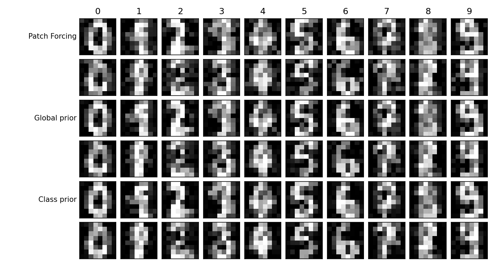
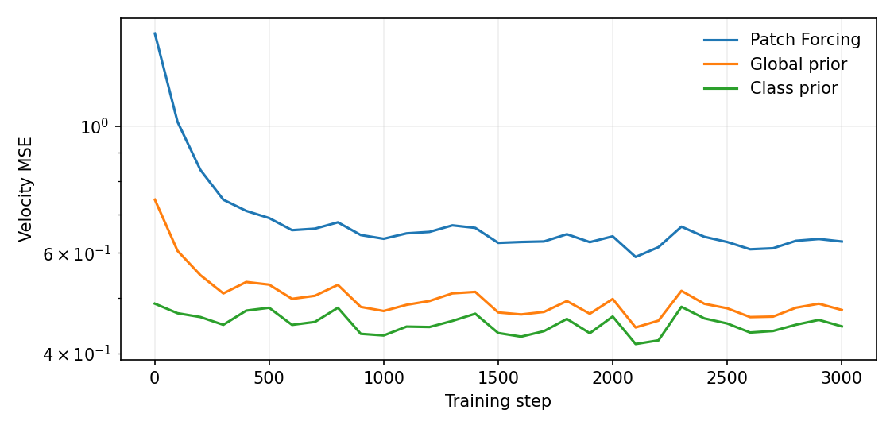

# Patch Forcing 的小规模复现与类别统计先验

给定类别 0–9，从高斯噪声生成一幅 8×8 手写数字图像。本项目在 CPU 上从头训练图块流模型，检验一个具体问题：显式提供训练集的像素均值和方差，能否帮助小网络学习类条件分布？代码与实验整理有 AI 辅助。

## 主论文和复现范围

Johannes Schusterbauer 等，*Denoising, Fast and Slow: Difficulty-Aware Adaptive Sampling for Image Generation*，CVPR 2026 主会，43260–43270 页。[CVF 正式论文](https://openaccess.thecvf.com/content/CVPR2026/html/Schusterbauer_Denoising_Fast_and_Slow_Difficulty-Aware_Adaptive_Sampling_for_Image_Generation_CVPR_2026_paper.html) · [原文及公式](https://arxiv.org/html/2604.19141v1) · [作者仓库的参考版本 8255494](https://github.com/CompVis/patch-forcing/tree/82554948508424db2667b07e0ffb6828cec7c129) · [CCF 目录](https://www.ccf.org.cn/Academic_Evaluation/AI/)

本仓库独立实现论文式 (3) 的受限逐块时间采样、式 (4) 的速度/不确定度双输出，以及第 3.3 节的难度驱动双循环。给每张图抽上界 sigmoid(0.5 + N(0,1))，按上界处截断的高斯在 [0, 上界] 内抽各块时间（标准差 0.2，用逆 CDF）。每块 2×2 像素，共 16 块。数据端为 t=1，噪声端为 t=0。网络输入整图状态、16 个时间和 10 维标签，共 90 维；tanh 隐层 128 维，输出 64 个速度修正与 16 个对数方差。总训练损失为像素速度 MSE + 0.01 倍高斯 NLL，似然项停止对速度的梯度。对数方差限制在 [−7,4]。本地用像素空间 MLP 替代论文的潜空间 Transformer，仅实现双循环和同步欧拉。我们未复现 ImageNet、look-ahead、REPA 或大模型 FID。

## 为什么引入统计先验

对直线路径 x_t=(1−t)z+tx，若噪声 z 为标准正态、数据像素 x 服从均值 μ、方差 q 的高斯，则给定 x_t 的条件平均速度为

    v_ref = μ + [t q − (1−t)] / [(1−t)² + t² q] · (x_t − t μ)
    v_pred = v_ref + MLP_velocity(x_t, patch_times, class)

这个解析项表达各像素的一阶、二阶统计，跨像素相关和非高斯形状由全图网络学习。三组共享同一网络结构与训练目标。pf 基线用 μ=0、q=1 的通用高斯跳连（本地参数化选择）。global 消融对全部训练图估计逐像素 μ、q。class 完整方法按类别估计它们。经验方差下限 0.02。三组均输入标签；只改变速度输出的参考项。推理时从相同标准噪声出发，双循环每轮将估计方差最小的 8 块推进一整步，其余推进半步，重新前向后完成余下半步。每张图 8 轮、16 次网络前向；同步欧拉也是 16 次。

## 环境与命令

测试环境为 Windows、AMD Ryzen 9 6900HX CPU、Python 3.13.9、BLAS 单线程。训练循环单种子单方法约 1.78–1.98 秒，首次导入、数据准备、保存和评测另计。从仓库根目录运行下列 PowerShell 命令。Digits 随 scikit-learn 安装，训练无需单独下载数据。[数据说明](https://scikit-learn.org/stable/modules/generated/sklearn.datasets.load_digits.html)

~~~powershell
python -m venv .venv
$py = '.\.venv\Scripts\python.exe'
& $py -m pip install -r requirements.txt
foreach ($s in 11,22,33) {
    foreach ($m in 'pf','global','class') {
        & $py experiment.py --mode $m --seed $s --steps 3000 --out repeat/runs
    }
}
& $py evaluate.py --runs repeat/runs --out repeat/results
~~~

直接用仓库内权重重建样例与指标：`python evaluate.py --runs runs --out repeat/results`。单次训练：`python experiment.py --mode class --seed 11 --out repeat/runs`。配置和计时在 runs/方法-种子/config.json，训练日志与 checkpoint.npz 在同目录。训练集 1437 张，测试集 360 张，分层划分种子 23，像素映射到 [−1,1]。每个模型训练 3000 步，批量 96，Adam 学习率 0.001，β=(0.9,0.999)，ε=1e−8。种子 11、22、33 各自配对初始权重、批次、时间与训练噪声。

## 三个训练种子的均值

每个检查点每种采样器生成 1000 张，每类 100 张，起始噪声种子 1201。命中率由只在训练集拟合的 RBF-SVM (C=10, gamma=scale) 评估，在真实测试图上命中率 99.44%。分布差异使用按类计算后等权平均的有偏估计 MMD²，RBF 核 gamma=1/32，值越低越接近测试样本。类内方差为对像素、类别平均的总体方差；真实测试图参照为 0.17025。全部计算在裁剪至 [−1,1] 的像素上。

| 训练版本 | 采样器 | 命中率 | MMD² ↓ | 类内方差 |
|---|---|---:|---:|---:|
| PF 基线 | 双循环 | 96.37% | 0.05193 | 0.11246 |
| 全局先验 | 双循环 | 98.03% | 0.03936 | 0.11537 |
| 类别先验 | 双循环 | 96.93% | 0.03606 | 0.11589 |
| PF 基线 | 同步 | 95.87% | 0.05342 | 0.11939 |
| 全局先验 | 同步 | 98.03% | 0.03964 | 0.11855 |
| 类别先验 | 同步 | 96.97% | 0.03623 | 0.11873 |

逐种子数据见 [metrics.csv](results/metrics.csv)。类别先验版本的 MMD² 在各个种子下均低于基线。全局先验的命中率最高。固定各版本权重改用同步采样时，类内方差均略升，MMD² 也略升。直接从类别对角高斯分布抽样的额外诊断得到命中率 96.80%、MMD² 0.04036、类内方差 0.12317；其与神经流均使用相同的标签和噪声。仅凭识别率难以判断笔画分布的拟合效果。统计项、训练后网络以及离散积分共同影响最终图像。三组的字形变化均弱于真实样本，结果限于此数据划分和固定测试协议。

