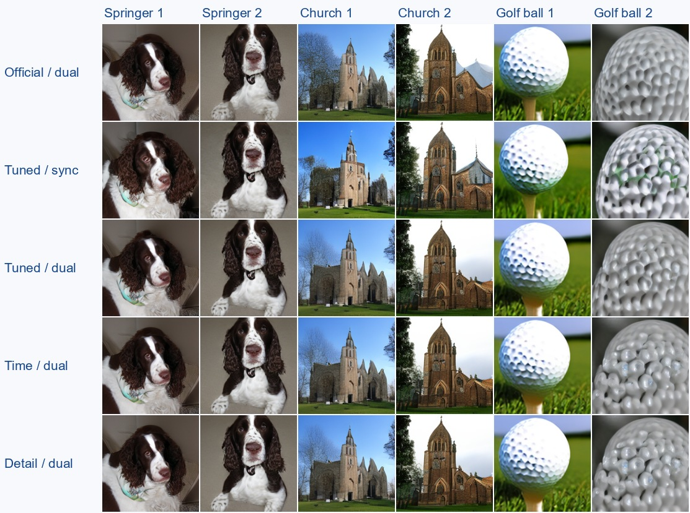

# Patch Forcing 在自然图像上的复现与图块难度校准

给定 ImageNet 类别编号与高斯噪声，生成一张 256×256 RGB 图像。本项目在 Imagenette 的英国史宾格犬、教堂、高尔夫球上微调作者 PFT-B/2 的输出投影，比较同步与双循环采样，并检验显式纹理线索能否帮助模型判断哪些块先去噪。代码和分析有 AI 辅助。仓库沿用最初的 URL，手写数字试验保存在[历史说明](README-digits.md)。

## 原论文与代码来源

**Patch-Forcing** was originally developed by CompVis / Ludwig-Maximilians-Universität München (LMU Munich). Based on the methods described in Johannes Schusterbauer, Ming Gui, Yusong Li, Pingchuan Ma, Felix Krause, Björn Ommer, *Denoising, Fast and Slow: Difficulty-Aware Adaptive Sampling for Image Generation*, CVPR 2026, pp. 43260–43270. [正式论文](https://openaccess.thecvf.com/content/CVPR2026/html/Schusterbauer_Denoising_Fast_and_Slow_Difficulty-Aware_Adaptive_Sampling_for_Image_Generation_CVPR_2026_paper.html) · [作者代码版本 8255494](https://github.com/CompVis/patch-forcing/tree/82554948508424db2667b07e0ffb6828cec7c129) · [上游非商业科研许可](https://github.com/CompVis/patch-forcing/blob/82554948508424db2667b07e0ffb6828cec7c129/LICENSE)。

直接加载该版本的 Transformer 类及作者的 PFT-B/2 400k EMA 权重，使用 SD VAE 对照片编码、对生成的潜变量解码。保留逐块时间、不确定度输出、原理一致的双循环调度、CFG。样本数、训练预算、噪声种子、训练范围、评测均为本地设置。验证集仅对本次微调留出，与 ImageNet 预训练数据可能重叠。

## 实际训练与改动

每张图的 4×32×32 潜变量分为 256 个 token。先抽整图时间上限 sigmoid(0.7 + N(0,1))，再按上游 LTG 规则为各块抽时间。速度目标为真实潜变量减噪声。三组共同最小化速度 MSE + 0.01 × 高斯 NLL，似然中的速度误差停止梯度。VAE 使用后验均值和尺度 0.18215。只有最终线性投影和外加校准层参与微调。

| 训练组 | 对数方差输出 | 可训练参数 |
|---|---|---:|
| pf | 线性投影输出 s | 15,380 |
| time | s + a·s + b·t + k | 15,383 |
| structure | 再加 c·d；d 是估计终点与 3×3 邻域均值的差值能量，跨通道平均后取 log1p | 15,384 |

假设是局部纹理对难度预测有额外信息。三个投影从同一个原始值独立初始化，每个模型有自己的优化器，新增系数均从零开始。校准只改变难度；通过选择先更新的块而影响生成。训练种子 23，批量 4、300 步、AdamW、lr=1e-4、无权重衰减。RTX 3060 Laptop 6 GB，共享主干前向的三个输出头联合训练循环 15.94 秒，编码与采样另计。[配置和日志](imagenette/results/config.json) · [训练轨迹](imagenette/results/loss.csv)

## 配对生成与验证结果

| 模型 / 采样 | 千类 Top-1 命中 | 条件 MMD² ↓ |
|---|---:|---:|
| 作者权重 / 双循环 | 47/48 | 0.234969 |
| 微调 pf / 同步 | 48/48 | 0.228423 |
| 微调 pf / 双循环 | 48/48 | 0.223619 |
| time / 双循环 | 47/48 | 0.223636 |
| structure / 双循环 | 47/48 | 0.223542 |

各组使用相同的 48 个噪声（种子 1201）、相同的类别序列（每类 16 张）、CFG=4。同步做 24 步，双循环做 6 轮 × 4 次整网前向。双循环每轮按方差第 40 百分位选出较易的块，一次推进整轮，其他块按四分之一步迭代。每次 CFG 同时计算无条件和有条件两个分支。ResNet-18 的 1000 类预测仅用于评测；真实验证图的同口径命中率是 62/96。分别在每类的 L2 归一化平均池化特征上，以 RBF 核 exp(−2‖x−y‖²) 估计有偏 MMD²，再求三类平均。以上均非作者的 FID-50K。

| 微调头 | 验证速度 MSE ↓ | 高斯 NLL ↓ | 图内 Spearman ↑ | 最易 102 块真实 MSE ↓ |
|---|---:|---:|---:|---:|
| pf | 0.730641 | 0.272846 | 0.681379 | 0.438016 |
| time | 0.730641 | 0.272625 | 0.681794 | 0.438366 |
| structure | 0.730641 | 0.272624 | 0.681809 | 0.438339 |

96 张验证图各构建一个可知真实速度的含噪状态，种子 9001。同一微调模型改用双循环，平均 MMD² 降低 0.004805，狗和教堂下降，高尔夫球上升。加入纹理后，相对 pf 双循环的 MMD² 只低约 0.000077，命中少一张；相对 time 的秩相关仅多 0.000015。一个训练种子和较小的评测集不足以支持稳定的纹理增益。[逐类结果](imagenette/results/by_class.csv) · [逐图预测](imagenette/results/predictions.csv) · [留出图误差](imagenette/results/validation.csv) · [基线全部 48 张图](imagenette/results/all-pf-dual.jpg)

## 从头复跑

测试环境为 Windows、Python 3.10.20、CUDA 12.1 版 PyTorch 2.2.0 / torchvision 0.17.0。以下 PowerShell 命令从本仓库根目录执行。较大依赖放在被 Git 忽略的 private 下。使用上游软件前请阅读其许可证。首先安装 CUDA 依赖。

~~~powershell
py -3.10 -m venv .venv
$py = '.\.venv\Scripts\python.exe'
& $py -m pip install torch==2.2.0 torchvision==0.17.0 --index-url https://download.pytorch.org/whl/cu121
& $py -m pip install -r imagenette/requirements.txt
New-Item -ItemType Directory -Force private/natural-data,private/weights/vae | Out-Null
git clone https://github.com/CompVis/patch-forcing private/pft-upstream
git -C private/pft-upstream checkout 82554948508424db2667b07e0ffb6828cec7c129
curl.exe -fL --retry 3 https://s3.amazonaws.com/fast-ai-imageclas/imagenette2-160.tgz -o private/natural-data/imagenette2-160.tgz
curl.exe -fL --retry 3 https://ommer-lab.com/files/pft/pft-b_step400k_ema.ckpt -o private/weights/pft-b.ckpt
curl.exe -fL --retry 3 https://huggingface.co/stabilityai/sd-vae-ft-ema/resolve/main/config.json -o private/weights/vae/config.json
curl.exe -fL --retry 3 https://huggingface.co/stabilityai/sd-vae-ft-ema/resolve/main/diffusion_pytorch_model.safetensors -o private/weights/vae/diffusion_pytorch_model.safetensors
curl.exe -fL --retry 3 https://download.pytorch.org/models/resnet18-f37072fd.pth -o private/weights/resnet18.pth
~~~

PFT-B 权重实测 SHA-256 为 941eeaf3a9c19639b57b22542614e6bd006b69f58437e825aedbd1baee188b57。使用 [Imagenette 官方 160 短边版](https://github.com/fastai/imagenette)。抽取英国史宾格犬（217）、教堂（497）、高尔夫球（574），每类从原训练目录取 96 张、验证目录取 32 张，RGB 中心裁剪并放大到 256×256。数据脚本校验压缩包；可对照[抽样清单](imagenette/results/manifest.csv)。

~~~powershell
$env:USE_TF = '0'
$d = 'private/natural-data'
$v = 'private/weights/vae'
$common = @('--upstream','private/pft-upstream','--checkpoint','private/weights/pft-b.ckpt')
$out = 'private/repeat-results'
& $py imagenette/prepare.py "$d/imagenette2-160.tgz" $d
& $py imagenette/natural.py encode --data $d --vae $v
& $py imagenette/natural.py train --data $d @common --out $out --steps 300 --batch 4 --seed 23
& $py imagenette/natural.py validate --data $d @common --out $out --batch 4
& $py imagenette/sample.py @common --out $out --vae $v --samples "$d/samples" --seed 1201 --per-class 16 --cfg 4
& $py imagenette/score.py --data $d --samples "$d/samples" --resnet private/weights/resnet18.pth --out $out
~~~

若从已发布的微调结果复算，将 $out 设为 imagenette/results，跳过 train。pf.pt、time.pt、structure.pt 仅包含本次训练产生的投影增量和新增系数，恢复时需配合指定作者权重。采样保存每组的 RGB 数组和标签；打分脚本从它们重建 JSON、CSV、配对预览和生成轨迹。作者权重、VAE、原始照片与个人报告均未随代码分发。

